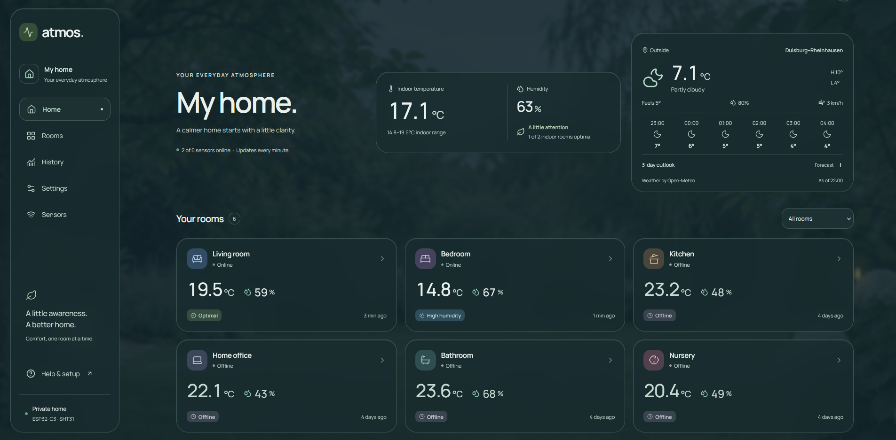
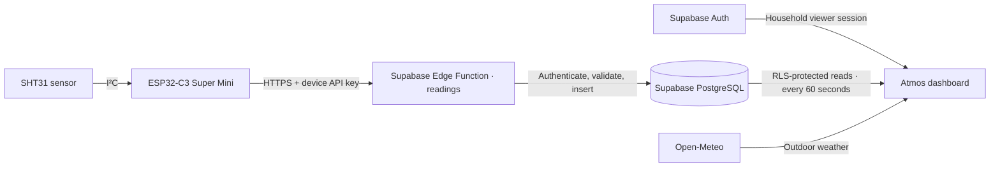

<div align="center">

# atmos.

### A little awareness. A better home.

A home climate monitoring project built around DIY sensors, a private dashboard, and a little everyday clarity.


[Open Atmos](https://atmos-eta-two.vercel.app/) · [Get started](#getting-started) · [Build a sensor](docs/ESP32-SETUP.md) · [How it works](#how-it-works)

</div>



<p align="center"><sub>The Atmos home dashboard: room-by-room readings, indoor comfort, and outdoor weather in one place.</sub></p>

## Why I built Atmos

I wanted a clearer picture of the temperature and humidity in my own home, room by room. Atmos grew from that idea into a project connecting physical sensors, firmware, a database, and a dashboard I can use every day.

**I assembled the sensor nodes myself using ESP32-C3 Super Mini boards and SHT31 temperature and humidity sensors.** Each node reads its room's conditions and sends them over Wi-Fi through a secure HTTPS endpoint. Atmos turns those readings into an overview of the home, with history for each room and a clear indication when a sensor stops reporting.

The interface is designed to feel calm: readable measurements, soft glass surfaces, and a garden background that responds to the weather and time of day. Indoor measurements come from the physical sensors; outdoor conditions come from a separate weather service.

The deployed app is a private household dashboard. A fresh local checkout can also run in a clearly labeled demo mode without cloud credentials.

## What Atmos does

- **Room-by-room monitoring** — temperature in °C, relative humidity, last reading, and sensor status on every card.
- **Climate history** — temperature and humidity charts for the last 24 hours, 7 days, or 30 days, with CSV export.
- **Automatic updates** — fresh readings appear every 60 seconds, with additional refreshes on reconnect and return to the app.
- **Indoor overview** — current home averages and comfort indicators that exclude offline, inactive, and unreported sensors, as well as rooms classified as outdoors.
- **Outdoor weather** — current conditions, an hourly forecast, and a three-day outlook from Open-Meteo.
- **Weather-aware appearance** — garden and minimal backgrounds, day/night atmosphere, light/dark/system themes, and adjustable motion.
- **Mobile-friendly access** — responsive layouts and PWA installation support for Android.
- **Private access** — Supabase authentication for household viewers and a separate API key for each sensor.

## The hardware

Each sensor node uses:

- **ESP32-C3 Super Mini** — the Wi-Fi microcontroller that runs the firmware and uploads readings.
- **SHT31** — the I²C temperature and relative humidity sensor.
- **A 3.3 V I²C connection** — with the following wiring:

```text
SHT31                         ESP32-C3 Super Mini
────────────────────────────────────────────────
VIN                           3.3V
GND                           GND
SDA                           GPIO 8
SCL                           GPIO 9
```

The firmware uses Arduino, `Wire`, Wi-Fi, the Adafruit SHT31 library, and certificate-validated HTTPS. It tries the SHT31's `0x44` address first, then `0x45`.

Two PlatformIO environments are included:

- **`testing`** — reads at startup and sends a reading every **60 seconds**, with bounded retries.
- **`low_power`** — wakes, reads the sensor, connects to Wi-Fi, sends the reading, and enters deep sleep for **5 minutes**. The full interval also includes the time spent awake.

Deep sleep is implemented in the firmware; battery life depends on the board, regulator, LEDs, power supply, and measured sleep current. See the [hardware guide](docs/ESP32-SETUP.md) for power considerations, GPIO 8/9 boot behavior, and placement tips.

## How it works



The dashboard is a **Next.js static export** hosted on Vercel. Sensor ingestion runs in a **Supabase Edge Function**, so it does not depend on a Next.js API server. New readings and devices are loaded at runtime; they do not require a frontend rebuild.

### Sensor ingestion

Each device sends a small JSON payload to:

```http
POST https://<project-ref>.supabase.co/functions/v1/readings
Authorization: Bearer <device-api-key>
Content-Type: application/json
```

```json
{
  "device_id": "YOUR_REGISTERED_DEVICE_UUID",
  "temperature": 21.4,
  "humidity": 48.2
}
```

The endpoint checks that the device exists, is active, and has a valid key. Temperature must be a finite number between **−40 and 85°C**; humidity must be between **0 and 100%**. The server assigns the reading's timestamp.

The firmware also sends an `X-Reading-Id` UUID to make retries idempotent: a successful retry returns the existing reading instead of inserting a duplicate. New readings return HTTP `201`; accepted duplicates return `200`. Per-device rate limiting permits a new reading at most once every 30 seconds.

### Data and access

- **`devices`** stores each sensor's UUID, name, room, active flag, and creation time.
- **`sensor_readings`** stores the device UUID, temperature, humidity, server timestamp, and optional ingestion request ID.
- **Private device credentials** store only SHA-256 hashes of randomly generated, per-device API keys. Keys can be rotated or revoked independently.
- **Row Level Security** restricts household reads to authenticated users with an administrator-assigned `climate_viewer` claim. Dashboard viewers cannot write sensor readings.
- **The Supabase service-role key stays on the server.** It is never put in the browser or ESP32 firmware.

The app is designed for **one private household per Supabase project**. Each room card represents a device UUID; devices with the same room label appear as separate cards.

### Reading freshness

A reporting device is **Online** while its last reading is less than 10 minutes old, and **Offline** once it reaches 10 minutes. Inactive devices and devices with no readings have separate states. Offline cards keep their last-known measurements visible and clearly mark them as stale.

The dashboard uses 60-second polling, rather than a Realtime subscription. History is aggregated in PostgreSQL into 15-minute, hourly, or 6-hour buckets for the selected range, avoiding REST row limits on longer histories. Home history averages are sample-weighted. Charts connect the available points; a gap does not mean a reading was recorded there.

Comfort indicators use **18–26°C** and **30–60% RH** as general reference ranges, not alarms.

## Built with

- **Frontend:** Next.js App Router, React, TypeScript, and Tailwind CSS.
- **Interface:** Recharts, Lucide icons, and the Manrope typeface.
- **Backend:** Supabase PostgreSQL, Auth, Row Level Security, and a TypeScript Edge Function.
- **Firmware:** Arduino C++ with PlatformIO, ESP32 Wi-Fi, `Wire`, and Adafruit SHT31.
- **Weather:** Open-Meteo forecast and geocoding APIs.
- **Hosting:** Vercel for the frontend; Supabase for the database and ingestion endpoint.

## Getting started

### 1. Run the dashboard locally

Requires **Node.js 22.12+** and npm.

```sh
git clone https://github.com/hans992/Atmos.git
cd Atmos
npm ci
npm run dev
```

Open [http://127.0.0.1:3000](http://127.0.0.1:3000).

Without Supabase environment variables, Atmos displays a labeled demo with six rooms and simulated history. Demo readings refresh every minute and are not persisted. This lets you explore the interface before setting up hardware or a database.

### 2. Connect your own Supabase project

For a **new project**:

1. Run [`supabase/schema.sql`](supabase/schema.sql) in the SQL Editor to create the tables, indexes, RLS policies, and history function.
2. Run [`supabase/ingestion.sql`](supabase/ingestion.sql) to add secure device ingestion.
3. Deploy the [`readings` Edge Function](supabase/functions/readings). Its gateway JWT verification is disabled because the function authenticates device API keys itself; keep that authentication in place. Follow the [backend setup instructions](docs/ESP32-SETUP.md).
4. Optionally run [`supabase/seed.sql`](supabase/seed.sql) **in a test database only** for six sample devices and 30 days of hourly readings.
5. Copy [`.env.example`](.env.example) to `.env.local` and configure the browser client:

```dotenv
NEXT_PUBLIC_SUPABASE_URL=https://YOUR_PROJECT.supabase.co
NEXT_PUBLIC_SUPABASE_PUBLISHABLE_KEY=sb_publishable_YOUR_KEY
```

The existing SmartHome installation already has its schema and ingestion setup. These instructions are for a fresh installation; sample data is not needed for live sensors.

### 3. Grant household access

Create an email/password user in **Supabase → Authentication → Users**. Then run the following as an administrator, replacing the email:

```sql
update auth.users
set raw_app_meta_data = coalesce(raw_app_meta_data, '{}'::jsonb)
  || '{"climate_viewer": true}'::jsonb
where email = 'YOUR_VIEWER_EMAIL';
```

Restart the development server and sign in. After changing a user's claim, sign out and back in to refresh the session. Existing JWTs retain their claims until they expire or refresh.

Environment variables are embedded at build time. Rebuild after changing the Supabase URL or publishable key. Never put a secret or service-role key in a `NEXT_PUBLIC_` variable.

### 4. Configure and flash a sensor

Register a device in `devices`, then generate its individual API key with the administrator helper:

```sh
node scripts/create-device-key.mjs YOUR_DEVICE_UUID ../bedroom-credentials
```

The helper writes a credential file and a SQL file outside the repository. Apply the generated SQL as an administrator to register the key hash. Keep the plaintext key private.

Copy `firmware/include/secrets.example.h` to `firmware/include/secrets.h` and configure:

- `WIFI_SSID` and `WIFI_PASSWORD` — your 2.4 GHz Wi-Fi network.
- `DEVICE_ID` — the UUID of the registered device.
- `DEVICE_API_KEY` — that device's unique API key.
- `API_URL` — your Supabase `readings` Edge Function URL.

With [PlatformIO](https://platformio.org/) installed and the board connected using a USB data cable:

```sh
cd firmware
pio run -e testing
pio device list
pio run -e testing -t upload --upload-port COM7
pio device monitor --port COM7 --baud 115200
```

Replace `COM7` with your board's port. The serial monitor should show an HTTP `201` response for a new reading. The dashboard picks it up on its next refresh, normally within 60 seconds.

Once normal uploads work, build and flash the five-minute sleep environment:

```sh
pio run -e low_power
pio run -e low_power -t upload --upload-port COM7
```

`secrets.h` is ignored by Git. Do not commit device credentials or configured firmware binaries. The [full hardware guide](docs/ESP32-SETUP.md) covers flashing mode, HTTPS certificates, troubleshooting, key rotation, and API responses.

## Weather and appearance

Open **Settings → Appearance & Atmosphere** to choose the theme, garden or minimal background, weather synchronization, and animation intensity. Motion respects the operating system's reduced-motion preference.

The configured home weather location is **Duisburg–Rheinhausen, Germany**, using district-level coordinates. You can change it through city search, coordinates, or optional browser location detection. Removing the location disables weather requests until another is selected.

Outdoor weather is independent of the sensor database. The personal dashboard uses Open-Meteo's public APIs without an API key. Cached or unavailable weather is handled explicitly; it never replaces indoor sensor measurements. See [weather settings, privacy, and caching](docs/WEATHER.md) for details.

The garden background is an illustration, not a photograph of the monitored home. Its provenance is documented in [Atmosphere asset notes](docs/ATMOSPHERE-ASSET.md).

## Deployment and PWA

```sh
npm run build
npm run preview
```

The build writes a static site to **`out/`**. On Vercel, configure the two public Supabase environment variables before building. Other HTTPS static hosts must serve directory `index.html` files, including `/room/index.html`; no SPA rewrite is required. Room detail URLs use `/room/?id=<uuid>` so newly registered devices work without generating new pages.

Atmos includes a web app manifest, regular and maskable icons, and an install control when supported by the browser. On Android, open the HTTPS app in Chrome and use **Install Atmos** or the browser's installation menu when available. Installation eligibility depends on the browser and hosting setup. The service worker is enabled in production builds, not the Next.js development server.

The offline behavior is deliberate: the service worker caches the offline page and app icons, **not sensor readings, dashboard HTML, API responses, or authentication**. An open dashboard retains its readings in memory and flags a lost connection. Reopening offline shows a reconnect page.

## Project layout

```text
Atmos/
├── src/
│   ├── app/                    Pages, styles, metadata, and PWA manifest
│   ├── components/             Navigation, room cards, charts, and providers
│   ├── lib/                    Typed data access, demo data, weather, and appearance
│   └── service-worker.ts       Offline fallback and icon caching
├── supabase/
│   ├── schema.sql              Database, access policies, and history aggregation
│   ├── ingestion.sql           Device credentials and ingestion rules
│   ├── seed.sql                Optional sample devices and readings
│   └── functions/readings/     Secure TypeScript ingestion endpoint
├── firmware/                   ESP32-C3 + SHT31 PlatformIO project
├── scripts/                    Device-key provisioning and build helpers
├── tests/                      Domain, ingestion, weather, and PostgreSQL checks
└── docs/                       Hardware setup, weather notes, and project images
```

## Development checks

```sh
npm run typecheck
npm test
npm run build
```

The test suite covers sensor status boundaries, payload validation, device authentication, retry deduplication, rate limiting, and weather behavior. Database tests run the SQL against PGlite's PostgreSQL runtime with local Supabase auth/role stubs to exercise constraints, RLS, and history aggregation. Physical sensor accuracy and power consumption need to be measured on the hardware.

## Documentation

- [ESP32-C3 + SHT31 setup](docs/ESP32-SETUP.md) — wiring, Wi-Fi configuration, device keys, flashing, deep sleep, and troubleshooting.
- [Weather and atmosphere](docs/WEATHER.md) — location settings, appearance, caching, privacy, and fallback behavior.
- [Atmosphere asset notes](docs/ATMOSPHERE-ASSET.md) — background illustration provenance.
- [Database schema](supabase/schema.sql) · [Ingestion setup](supabase/ingestion.sql) · [Sample data](supabase/seed.sql).

---

<p align="center">A personal hardware and software project by <a href="https://github.com/hans992">hans992</a>.<br><sub>Comfort, one room at a time.</sub></p>

## Indoor Climate Intelligence

Room cards and detail pages now include absolute humidity, dew point, estimated mold risk, and weather-aware ventilation guidance. Expand **Climate Insights** to inspect recent trends and customize room thresholds. Preferences are stored on this browser. See [formulas, thresholds and limitations](docs/climate-intelligence.md). No database migration or firmware update is required.
